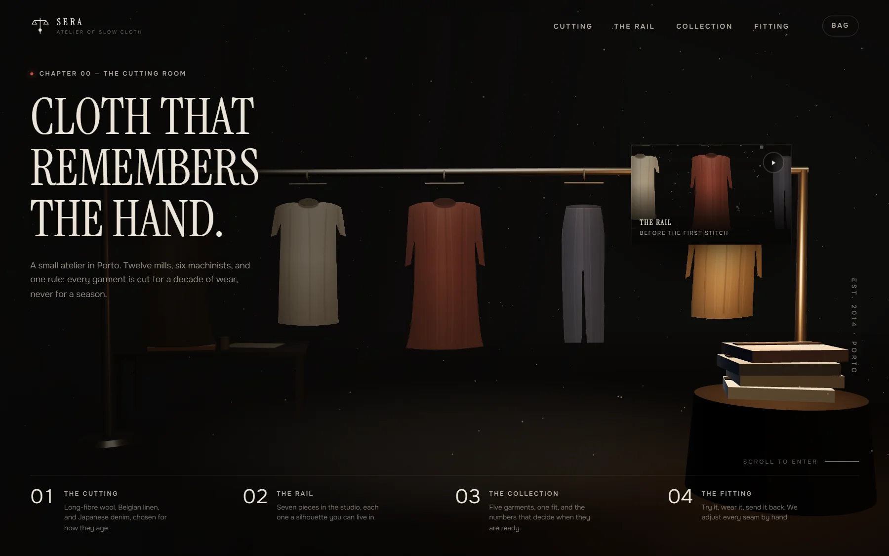
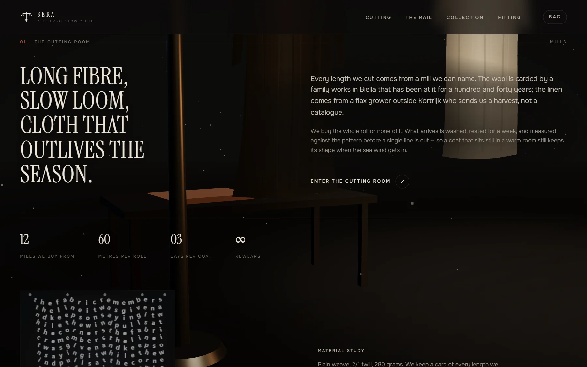
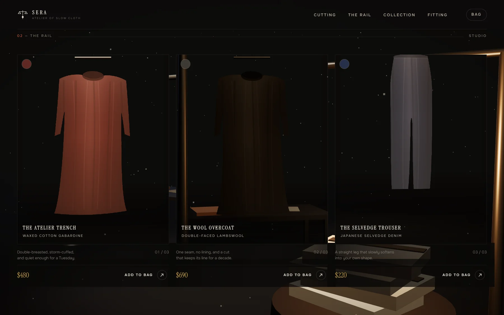
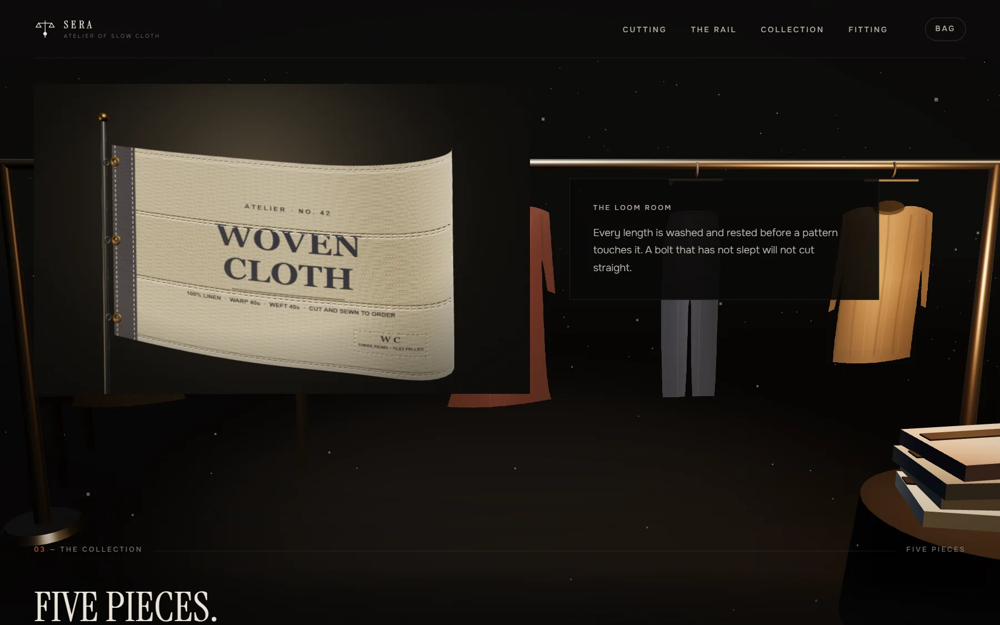
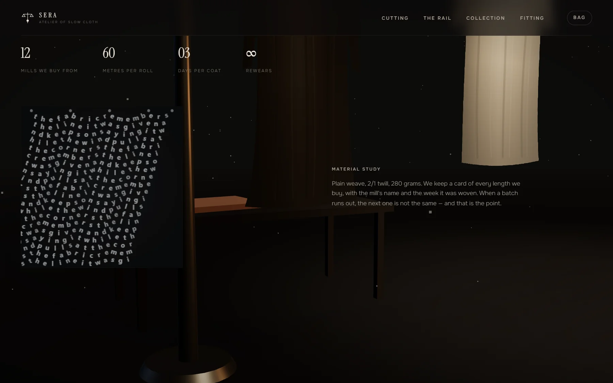
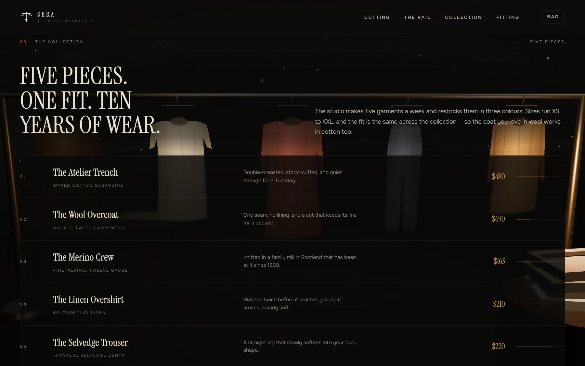
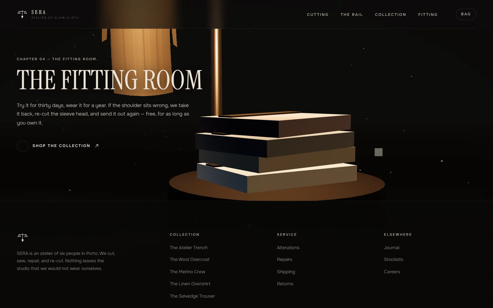
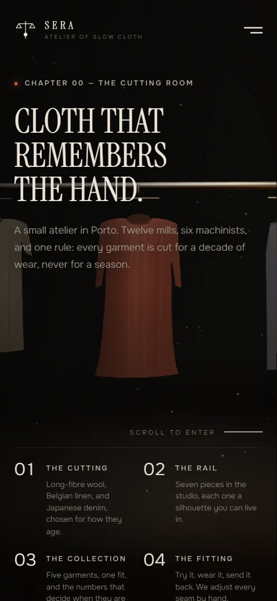
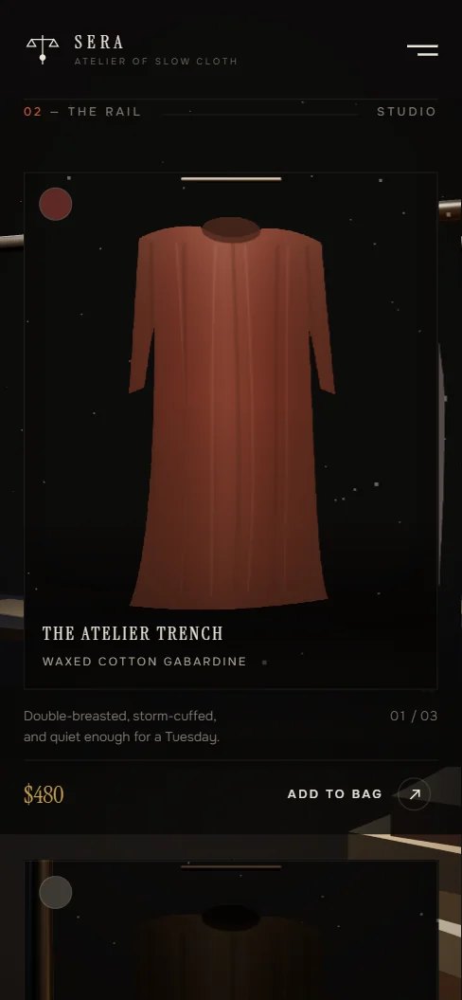

# SERA — Atelier of slow cloth



A single-page storefront for a fictional garment atelier, built on the
[ThreeUI Community](https://github.com/MengTo/threeui) library
(`@designcodeio/threeui`) and a hand-written three.js scene.

The page follows the architecture of the ThreeUI Kage landing page
(`https://threeui.com/landing-pages/kage-landing-page`): a fixed WebGL stage
behind the document, a preloader, a floating nav, a full-viewport hero with
chapter chips and a live preview window, four scroll chapters, and a colophon
footer. Every word is English, and every piece of content is about selling
garments.

## Preview

All images below are real captures of the running app.

| Chapter I — the cutting room | Chapter II — the rail |
| :--- | :--- |
|  |  |

| The loom band (ThreeUI `WovenCloth`) | The material study (ThreeUI `ClothStudy`) |
| :--- | :--- |
|  |  |

| Chapter III — the collection | Chapter IV — the fitting room |
| :--- | :--- |
|  |  |

<p align="center">
  
  
</p>

## Stack

| Piece | Choice |
| --- | --- |
| Build | Vite 7, TypeScript 5.9 |
| UI | React 19 |
| 3D | three.js 0.165 (own scene, not a library preset) |
| Library | `@designcodeio/threeui` 1.2.0 (Community) |

## Run it

```bash
npm install
npm run dev      # http://127.0.0.1:5173
npm run build    # type-check + production bundle into dist/
npm run preview  # serve the production build
npm run typecheck
```

## How the Kage page maps onto this one

| Kage | SERA |
| --- | --- |
| Preloader over a night temple | Preloader over a lit atelier; the bar tracks the scene build |
| Fixed nav, brand + chapter links + burger | Same, plus a bag button with a live count |
| Hero: eyebrow, three-line display, sub, scroll cue, four chapter chips, floating preview window | Same, for the cutting room, the rail, the collection and the fitting room |
| Chapter I — the gate: heading, lead copy, arrow link, stats row | Chapter I — The Cutting Room, with mill stats |
| Chapter II — the pathways: three staggered cards, each a live viewport | Chapter II — The Rail: three product cards, each a live 3D viewport of the garment it sells |
| Chapter III — five lessons | Chapter III — The Collection: five pieces with prices, stock levels and an expandable detail row |
| Chapter IV — the closing horizon and CTA | Chapter IV — The Fitting Room and its CTA |
| Footer colophon | Footer with the brand blurb, three link columns and a base bar |

## The three.js scene

`src/scene/atelierScene.ts` owns the stage. It is not a library preset: the
garments are painted at runtime.

- **Garments.** Each piece is a transparent canvas texture (silhouette, fold
  shading, weave) mapped onto a plane that is displaced in the vertex stage, so
  the cloth sways and bellies like fabric. Coats, shirts, knits and trousers
  have their own silhouettes.
- **Live viewports.** Product cards and the hero preview are holes punched in
  the page: the renderer draws the same scene again through a scissored
  viewport and a per-card camera, so each card is a window onto a different
  corner of the atelier. The hero preview drifts like a turntable.
- **Chapter cameras.** Scrolling moves the camera between six fixed
  positions (hero, four chapters, footer) with damped interpolation, plus a
  small pointer parallax.
- **Cost.** One renderer, one canvas, no post-processing chain, no shadow
  maps, no external textures. The grain and the vignette are CSS layers.

## What comes from the library

- `WovenCloth` (atelier variant) — the loom band between the rail and the
  collection. It renders a full HTML document of its own, so it brings its
  assets with it.
- `ClothStudy` — the material-study plate in the cutting room.
- `@designcodeio/threeui/style.css` — imported once in `src/main.tsx`.

Everything else on the page is local to this project.

## The shop

The bag is real state: `src/App.tsx` holds a `Record<productId, quantity>`,
the nav shows the count, the drawer lists lines and a total, and adding a piece
raises a toast. There is no checkout endpoint behind the button.

## Notes

- Every garment image is generated at runtime; the project ships no binary
  assets beyond the library's own and the screenshots in `docs/screenshots/`.
- `prefers-reduced-motion` disables the reveal transitions, the hero cue and
  the camera drift.
- The page is responsive down to 390px: the nav collapses to a sheet, the
  chapter chips go two-up, and the product cards stack.
